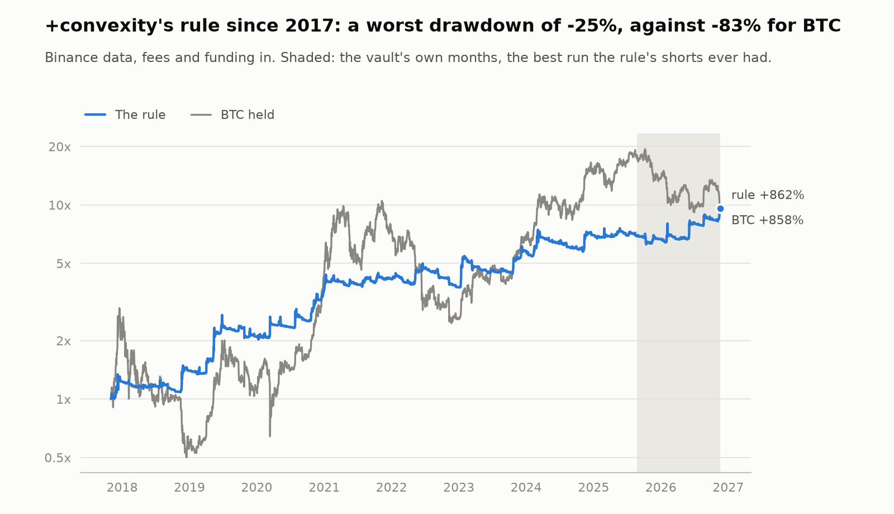
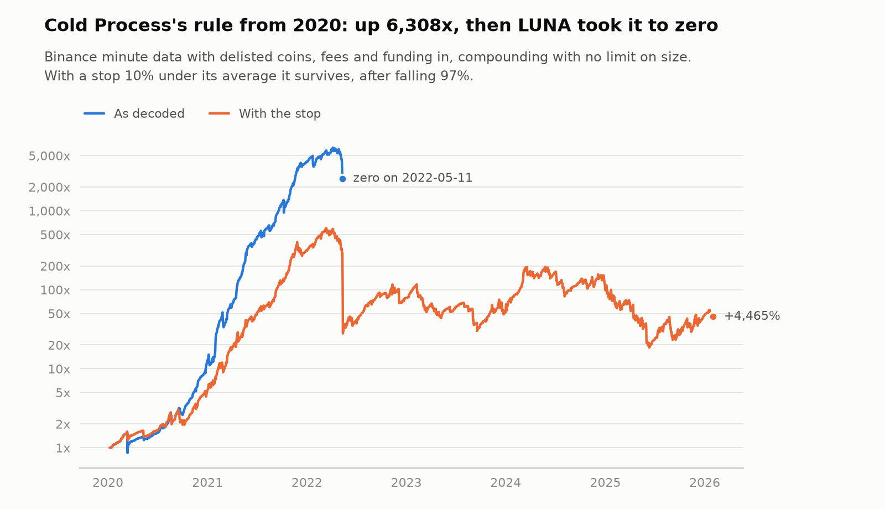

# Findings: +convexity and Cold Process

Two Hyperliquid vaults, rebuilt from their public fills and orders and tested as strategies of our own:
+convexity in sections 1-5, Cold Process in section 6.

+convexity is a Hyperliquid vault (`0x5661a070eb13c7c55ac3210b2447d4bea426cbf5`) that trades BTC once a day. We
rebuilt it from its public fills and orders, then tested whether its rule works as a strategy of its own. Astraeus's
[decode](https://x.com/AstraeusCap/status/2122868247972180231) (2026-11-18) got us started; we treated his claims as
hypotheses and checked them along the way. Work done 2026-11-20 to 11-23. The test and the backtest were
pre-registered, and each holdout was read once.

## Summary
- **The vault:** one GTC limit order a day at 01:45:06-10 UTC, BTC only. From Sep 2025 to Nov 2026 it made +90%
  flow-neutral while BTC fell 43%; Sharpe 1.84 daily (~1.5 weekly, as returns are autocorrelated); max drawdown
  -16%. Its five best days carry 83% of the log return.
- **The decode holds:** its sizing is the rule Astraeus published. Out of sample we get R² 0.67 on the vault's
  position (he reports ~0.70) and 76% of its trade directions (77%). Run on its own, the rule earns 78-84% of the
  vault's P&L.
- **As a strategy of its own it fails our bar.** Over 2017-11 to 2025-08 on Binance, with funding and costs:
  Sharpe 0.95 and max drawdown -25%, against 0.74 and -83% for holding BTC. After removing what holding and plain
  30-day momentum explain, the alpha (Sharpe 0.64) can't be told from luck once you count the trend rules already
  tried on that history (deflated Sharpe 0.16 at 250 trials, 0.76 even at 5).
- **On Hyperliquid before the vault existed** (2024-02 to 2025-08) it made +8.9%, all of it on a few days.
- **The vault's 15 months were the best run the rule's short side ever had** (+44% on short days). By total return, about a third of the rule's 15-month windows did better.
- **Funding** costs this rule 3-7% a year. A 1x BTC long paid 13% a year on Binance from 2019 and 19% a year on
  Hyperliquid in 2024-25.
- **Not reproduced:** the article's two-state "1/8 size" tilt and its funding-sign switch.
- **His cross-sectional sleeve reproduces** on our own Binance perp data (Sharpe 1.42 at 2 bps against his 1.56), but
  it's half plain cross-sectional momentum, it lost in 2023-24, and its extra can't be told from luck (section 5).
- **A second vault, Cold Process,** is a DCA grid bot whose ladder decodes cleanly. Run with a rule picking its
  coins, it was wiped out by LUNA in 2022; its record rests on coin picks we couldn't decode (section 6).

## 1. Rebuilding the vault
- **Fills:** 4,965 from 2025-08-23 to 2026-11-20. Paging `userFillsByTime` from the newest fill + 1 ms loses fills
  when a 2,000-fill page ends inside a millisecond (one order fills many times in one); that cost us 4 fills ($37k
  notional) until each page restarted at its newest millisecond. Fills inside a millisecond also arrive unordered;
  chaining them by `startPosition` orders them and exposes any gap.
- **Account value**, rebuilt from fills, funding and the deposit ledger, matches the vault's own reported history to
  a median ~0.0%. Withdrawals have to leave at `requestedUsd`, since the leader's 10% commission leaves the vault
  too.
- **Orders:** 374 of 385 were placed at 01:45:06-10 UTC as GTC limits within a few bps of the price; ~65% of
  notional filled as maker. Some rest for hours: a -2.37x order placed 2026-06-02 filled at 03:05 and alone is 22% of
  the log return. So every nightly table here sizes a night by the order's intent (`origSz`), never by the position
  at a cutoff.
- **Performance**, flow-neutral (hourly P&L over the account value going in): +90% from 2025-09-01; Sharpe 1.84 on
  daily closes, 1.77 on the 01:45 clock, ~1.5 weekly; 90% block-bootstrap interval 0.0 to 3.1. More than 5% under
  water on ~43% of days. Leverage median 0.26x, max 2.37x.
- **Survivorship:** 6,432 of the 9,478 vaults Hyperliquid lists have closed. Any surviving vault's record carries it.

## 2. The rule
As published, and as we tested it:
- trend s = ln(EMA48h / EMA480h) on hourly closes (EMA span N, alpha = 2/(N+1))
- participation v = the last 24 hours' volume over the 30-day daily mean
- variance σ² = 8,760 x the EWMA (span 336 h) of hourly squared log returns
- target L* = c · s · v / σ²; each night at 01:45 UTC, L = L_prev + 0.8 (L* - L_prev)

c is fitted by least squares on the fit window only. Our own first fit, trend over volatility alone
(clip(0.25 x (EMA3d / EMA14d - 1) / vol20, ±0.75)), explained the vault's position almost as well (R² ~0.55) but
only a quarter to a third of its P&L, because it can't size up on the big nights. The volume and variance terms put
the size there: a fast move on heavy volume, before the 14-day variance estimate catches up.

## 3. Testing the article's claims
Pre-registered before the data was pulled. One row per night (454 nights), sized by the 01:45 order's intent. Two
splits: his (fit to 2026-02-28, test 2026-03-01 to 11-20) and halves. Every variant moves 0.8 of the way each night
and has one fitted scale.

His split, test window (265 nights), replays without costs:

| Model | Level R² | Order R² | Direction | P&L vs vault | Sharpe | Big nights |
|---|---|---|---|---|---|---|
| yesterday's exposure | 0.41 | 0.00 | | | | |
| trend / σ | 0.58 | 0.29 | 73% | 34% | 1.39 | 46% |
| trend / σ² | 0.59 | 0.30 | 70% | 49% | 1.67 | 53% |
| trend · volume / σ | 0.63 | 0.38 | 79% | 49% | 1.62 | 68% |
| **trend · volume / σ² (his)** | **0.67** | **0.44** | **76%** | **78%** | **1.91** | **85%** |
| our first fit (EMA3d/14d) | 0.55 | 0.23 | 70% | 31% | 1.24 | 45% |

The vault's own replay Sharpe over those nights is 2.35. On the halves split his rule gets 0.68 / 0.44 / 75% / 84%
/ 2.30, against the vault's 2.62. "Big nights" is the share of the vault's exposure the rule matches on nights above
1x.

Against the pre-registered bars:
- **His headline holds:** R² 0.67 and 76% direction against his ~0.70 and 77%.
- **Volume and variance** each help on both splits, but neither clears a 90% block bootstrap on its own (volume:
  +0.15 order R², interval -0.02 to +0.27).
- **Two-state tilt: not reproduced.** A two-component mixture fits the residual size multiplier better than one,
  but with weight 0.41, "off" at 0.45x with a wide spread, "on" at 1.14x, and no persistence (P(off | off) 17%,
  P(off | on) 21%). He reports 0.21, 0.13x and 1.12x.
- **Funding switch: not supported.** "Off" nights aren't likelier after negative funding (17 of 63 against 70 of
  270, p 0.49).
- **Concentration:** the vault's five biggest test nights carry nearly all of it; without them the vault makes +3.2%
  and the rule -2.5%. The rule's P&L share has a 90% bootstrap interval of 28-105%.

## 4. Backtest as a strategy of our own
Pre-registered before the long history was pulled. The holdout was read once, after the engine reproduced the
replication replay (+43.7% vs +44.7%, daily correlation 0.98) and a dry run of the read code on seen data.

- **Rule** frozen as published, with c frozen from the vault's fit window. Signal at the 01:00 hourly close, filled
  at the 02:00 close, held to the next night's. Taker fees, 5 bps a side on Binance and 4.5 on Hyperliquid, with a
  10 bps stress; funding paid at each settlement; leverage drifts with price between rebalances.
- **Holdout**, data the rule never saw: Binance 2017-11-01 to 2025-08-23 (spot prices and volume; perp funding from
  2019-09), and Hyperliquid 2024-02-01 to 2025-08-23 (its daily volume and hourly funding; Binance hourly prices,
  since Hyperliquid's API keeps only ~7 months of hourly candles).
- **Gates**, adapted from our research protocol. On Binance:
  - the deflated Sharpe of the alpha over buy-and-hold and 30-day momentum is at least 0.80 at N = 250, the trend-rule variants we had already tested on overlapping BTC history, rounded up
  - profitable at 10 bps
  - at least 55% of half-years profitable
  - max drawdown within 2.5 x annual volatility
  - profitable without its five best days, and without its best month
  - at least 3 of 5 neighbouring parameter sets (fast 36-60 h, slow 360-600 h) profitable

  On Hyperliquid: profitable at 10 bps, plus the drawdown and both concentration gates.

**Binance, 2017-11 to 2025-08 (2,853 nights):** CAGR +28.1%, vol 30.9%, Sharpe 0.95, max drawdown -25.2%; Sharpe
0.90 at 10 bps. Holding 1x: 0.74, -83%. 30-day momentum 1x: 0.58, -87.5%. Exposures +0.05 to holding and +0.27 to
momentum leave an alpha with Sharpe 0.64 over 3,127 effective days: deflated Sharpe 0.16 at N 250, 0.76 at N 5,
0.08 at N 1,000. It passes every other gate: 11 of 15 half-years, all five neighbours profitable (+509% to +650%).

**Hyperliquid, 2024-02 to 2025-08 (570 nights):** +8.9%, Sharpe 0.34, max drawdown -25.0%; +4.4% at 10 bps. Not
profitable without its five best days, or without its best month.

By regime, one continuous book on Binance inputs:

| Period | Rule | Sharpe | Long days | Short days | BTC |
|---|---|---|---|---|---|
| 2017-18 top and bear | +40.0% | 1.00 | +19.0% | +21.6% | -43% |
| 2019 | +49.8% | 1.19 | +58.4% | -9.9% | +96% |
| 2020-21 bull | +97.8% | 1.22 | +67.8% | +10.2% | +548% |
| 2022 bear | -8.9% | -0.38 | -19.2% | +11.8% | -65% |
| 2023-24 bull | +85.0% | 1.20 | +95.4% | -25.5% | +466% |
| 2025 before the vault | -1.1% | 0.00 | +3.8% | -3.8% | +23% |
| the vault's period (in sample) | +39.2% | 1.07 | -6.0% | +44.2% | -47% |

**Funding:** -3.1% a year on Binance over the window (-4.0% from 2019, when perps start), and -7.2% a year on
Hyperliquid, where it cut the return from +13.5% to +5.6% a year. Nearly all of it is paid on long days, so it bites
in bull markets, which is where the rule makes its money.

### Beyond BTC
We then ran the frozen rule on other coins, unchanged: c from BTC, each coin's own perp volume, Binance funding,
5 bps a side. Pre-registered and read once (2026-11-25 and 11-27), decisions 2021-01 to 2025-08 gated, then
2025-08 to 2026-09 reported (`coins_read.py`, `repick_read.py`).
- **A fixed list**, picked by 2020 volume so no later knowledge went into it: ETH, SOL and the 8 busiest of 2020
  (XRP, LINK, BCH, LTC, YFI, EOS, ADA, BNB). As an equal-weight basket: +89%, Sharpe 0.83, worst drawdown -21%,
  profitable in 7 of 9 half-years. Four of the ten coins lost money; YFI fell 90% at its worst.
- **The version you'd trade**, the 10 busiest coins re-picked monthly (from 2023-05 only coins Hyperliquid lists),
  with a top-15 buffer, and a coin that drops out winds its position down instead of being closed on the
  calendar: +55%, Sharpe 0.64, worst drawdown -19%. Busier coins earned less than the 2020 majors did.
- **No edge of its own.** Over holding the coins and their 30-day momentum, the fixed list leaves a deflated Sharpe
  of 0.02. It's trend exposure on alts. What it could add is diversification next to a long book; we judged that
  against our own live strategy, privately.
- After the gated period the two went different ways: the fixed list lost 5.8%, the re-picked list made 3.2%.

## 5. The article's cross-sectional sleeve
His tradeable version mixes the BTC rule 50/50 with a cross-sectional sleeve: the same score ranks ~625 Binance
perps, long the top and short the bottom. He reports Sharpe 1.45-1.63, plain and gross, with no funding mentioned.
Those numbers are out of sample for the rule's parameters, which came from the vault, and in sample for the
sleeve's design, chosen on the same 2020-2026 data.

We reproduced it, pre-registered, on our own Binance USDT-M perp data: March 2020 to September 2025, delisted coins
included, a coin traded only once listed 30 days and above $10M a day, rebalanced daily, 1x isolated margin per
position, funding at every settlement. That data and engine aren't in this repo.
- **His number holds.** Sharpe 1.42 at 2 bps (he reports 1.56), 1.34 at 5 bps with funding, 0.93 at 10 bps. The
  50/50 mix with the BTC rule: 1.84 gross (his 1.63). The two sleeves correlate 0.045 (his 0.05).
- **It's half plain cross-sectional momentum** (long the top third by 30-day return, short the bottom third). What's
  left is an alpha with Sharpe 1.15 (t ~2.7), which can't be told from luck once you count the ~1,000 strategies we
  have tested on the same data (deflated Sharpe 0.28).
- **It depends on the regime.** Sharpe 3.07 in 2020-21, 0.39 in 2022, -0.47 in 2023-24, 2.10 in 2025. The mix stays
  positive in every period only because the BTC rule carried 2023-24.
- **Turnover** is ~60% of capital a day, so break-even is ~20 bps a side; the article says 60.

So the sleeve is real enough to reproduce, and only forward data can tell whether its extra over momentum is an
edge.

## 6. A second vault: Cold Process, a DCA grid
Cold Process (`0xc3b1bf1f1e6fb8161ef4dc2f34e2c56f70b94b11`) trades Hyperliquid alts long only, one deal at a time:
+193% flow-neutral from February to November 2026, max drawdown -13%, 99.5% of 1,752 deals closed in profit.
`decode_grid.py` rebuilds its rule from 16,447 fills:
- An entry of 1.23% of account value, a take-profit 1.34% over the average entry, and resting buys 2.6, 4.1, 5.9,
  8.0, 11.0, 12.4 and 14.9% under the entry, the first 1.33x the entry and each later one 2.33x the one before.
  Past about six rungs (~1.25x account value) the position stops growing: it sells pieces under its average while
  still buying deeper dips, and waits for a bounce.
- It picks among Hyperliquid's busiest, most volatile coins, but no simple rule reproduces the picks: the best
  ones name its coin first at 17-21% of deal starts (`selection.py`, `grid_backtest.py fit`).

We backtested the rule as our own strategy on Binance minute data from 2020 to January 2026, delisted coins
included (`grid_backtest.py`). Pre-registered before pulling the history: one deal at a time, on the most volatile
over 7 days of the 10 coins with most 24h volume, among every Binance coin until Hyperliquid listed 20 perps
(2023-05-24) and among Hyperliquid's list at that moment after; at the cap, sell 1/72 of the position at each
hourly close under the average. Costs from the vault's own fills: 4.5 bps taker on entries and forced sales,
1.5 bps maker on rungs and take-profits, 10 bps on everything as the stress; Binance funding. Gates as in section
4, with the alpha taken over holding BTC and over the 10-coin pool, and 1,100 trials counted (a 1,080-cell grid of
dip-buying rules we had tested on Hyperliquid alts, plus this family). The universe was amended before the holdout
read, once the first version turned out to pick Binance's fresh pump listings, which the vault never trades. One
rerun fixed frozen bars on delisted contracts.
- **The engine reproduces the vault.** Its own 1,616 entries replayed on Binance minutes give the same ladder: 67%
  of deals close with no add (the vault: 64%), median deal 0.9 h (1.0 h).
- **The coins carry the result.** From February to October 2026 the grid compounds to +90% on the vault's own
  entries (the vault itself: +166%), and loses 19%, after a 71% drawdown, when a rule picks the coins.

- **One crash ends it.** Over 2020-2026 the rule harvests ~0.1% of equity per take-profit, about 16 a day, and
  compounds to absurd numbers through 2021. On 2022-05-10 it holds LUNA at the cap and loses everything within 13
  hours. Holding at the cap does no better; a stop 10% under the average survives but loses 91% that week, and
  every variant that survived went through a 97-99% drawdown.

So the vault's record is a short-volatility harvest, and its survival rests on how it picks coins and handles
deep deals, neither of which shows in its fills.

Binance's data archive keeps publishing frozen bars for delisted contracts (FTT at 1.59 every minute since
November 2022): end a coin's life at its last hour with volume.

## Hyperliquid API notes
- `userFillsByTime`: 2,000 fills a page, the latest 10,000 kept. Restart each page at its newest millisecond and
  dedupe by `tid`.
- `historicalOrders`: placement time, `origSz` and `limitPx` for each order; the latest 2,000 rows.
- `userFunding`: daily buckets stamped at the day's start before 2026-11-13, hourly after.
- `candleSnapshot`: the last 5,000 candles per interval. Daily candles from before a coin's listing are backfilled
  with zero volume and zero trades (BTC's before 2023-02-26), so the first candle with trades dates a listing.
- `fundingHistory` for BTC starts 2023-05-12.
- A vault's deposit records don't name the depositor. A withdrawal takes `requestedUsd`, commission included, out of
  account value.

## Reproduce
`CLAUDE.md` lists the steps. `pull.py` and `binance_archive.py` download everything from public sources. The
holdout reads are guarded: `backtest.py holdout` and `grid_backtest.py holdout` refuse to run twice.
