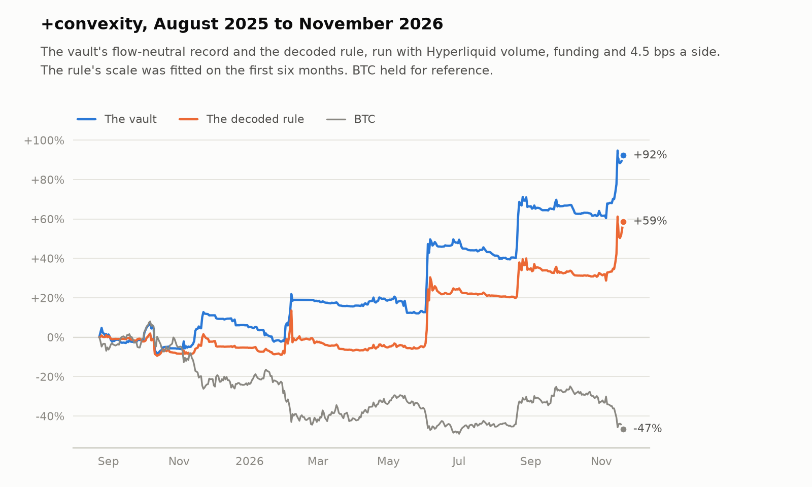
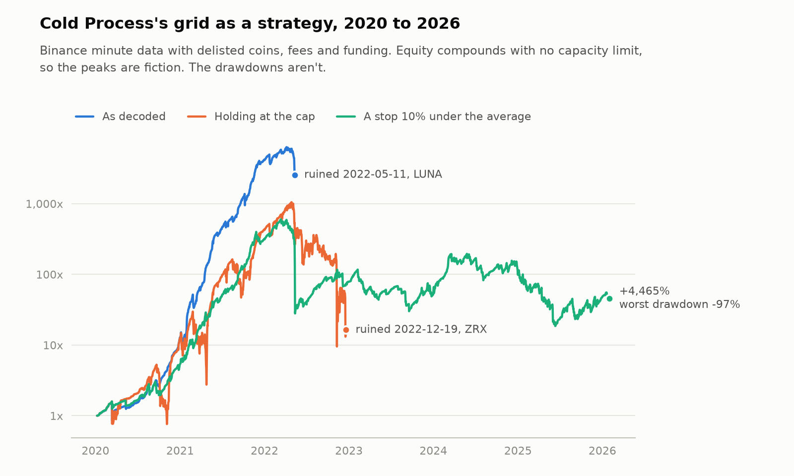

# vault-re

Reverse-engineering Hyperliquid vaults from their public fills and orders, then checking whether the rules hold up as
strategies on their own.

First vault: [+convexity](https://app.hyperliquid.xyz/vaults/0x5661a070eb13c7c55ac3210b2447d4bea426cbf5), a BTC trend
follower that trades once a day. Inspired by [Astraeus's decode](https://x.com/AstraeusCap/status/2122868247972180231).
We rebuilt the vault from scratch, checked his claims, then backtested the rule over 2017-2025 with fees and funding,
pre-registered, holdout read once.

The rule tracks the vault well. Run on its own it's a low-leverage BTC trend follower whose edge over buy-and-hold
and plain momentum is within luck. His cross-sectional sleeve reproduces on our own Binance perp data, but it's
mostly plain momentum and lost in 2023-24.

<picture>
  <source media="(prefers-color-scheme: dark)" srcset="charts/convexity-dark.png">
  
</picture>

Second vault: [Cold Process](https://app.hyperliquid.xyz/vaults/0xc3b1bf1f1e6fb8161ef4dc2f34e2c56f70b94b11), a DCA
grid on Hyperliquid alts that closed 99.5% of its deals in profit. Its ladder decodes cleanly, its coin picks don't,
and the picks carry the record. Run with a rule picking the coins on Binance minute data, the grid compounds to
absurd numbers through 2021 and LUNA wipes it out in May 2022.

<picture>
  <source media="(prefers-color-scheme: dark)" srcset="charts/grid-crash-dark.png">
  
</picture>

Numbers in [FINDINGS.md](FINDINGS.md).

## Code
- `pull.py`: complete vault fills and orders, Binance and Hyperliquid market data. Public APIs, no keys.
- `book.py`, `equity.py`: position, P&L and account value at any point, checked against the vault's own history.
- `nightly.py`: one row per daily decision, sized by order intent.
- `rule.py`, `astraeus_test.py`: the decoded rule and the test of the article's claims.
- `backtest.py`, `stats.py`: nightly engine with fees, funding and drift; deflated Sharpe.
- `describe.py`, `match.py`, `daily.py`, `sizing.py`: first exploratory passes.
- `fingerprint.py`: what any vault does, from its fills, TWAPs and positions.
- `decode_grid.py`, `selection.py`: a grid bot's ladder and take-profit, and how it picks its coins.
- `binance_archive.py`: Binance's public archive of USDT perps, delisted coins included.
- `grid_backtest.py`: minute-path engine for the grid, with fees, funding and the pre-registered read.
- `charts.py`: the charts, light and dark.

Steps in `CLAUDE.md`. Runs on Python with numpy, scipy, requests and matplotlib (`uv run --no-project --with numpy
--with scipy --with requests --with matplotlib python <script>`). Data isn't in the repo, `pull.py` and
`binance_archive.py` fetch it. Read-only, nothing here trades.

MIT licensed.
